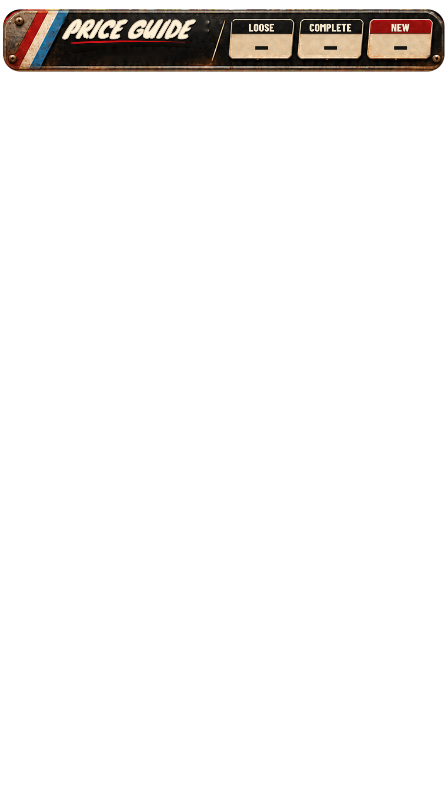

# Whatnot AI Game Overlay

Hold a retro video game up to your Sony ZV-1 during a Whatnot auction. The app identifies the
game and its console with Claude Vision, validates the match against the PriceCharting catalog,
fetches the current **Loose / Complete / New** market values from the official PriceCharting API,
and shows them on your stream in a slim price strip across the top — automatically, game after game.


| Between games | Long title | Six-figure prices | Missing value (`N/A`) | 360px phone | 16:9 layout |
|---|---|---|---|---|---|
|  |  |  |  |  |  |

*(Screenshots are rendered by the automated browser tests with mock PriceCharting data; the
background is transparent in OBS. The fonts are bundled with the app, so OBS on Windows renders
the same lettering.)*

> **Status:** fully implemented and tested with mocks, fakes and a real browser. It has **not yet
> been run against your live OBS, Sony ZV-1, Anthropic account or PriceCharting account** — those
> need your credentials and hardware. See [docs/PRODUCTION_READINESS.md](docs/PRODUCTION_READINESS.md)
> for exactly what was and was not verified, and the first-live-session checklist.

---

## Quick start (Windows)

1. **Install** — double-click **`Install.cmd`** (needs Python 3.12+; the script tells you how to get
   it if missing). It creates a private virtual environment, installs pinned dependencies,
   initializes the database and creates desktop shortcuts.
2. **Try the demo** — double-click **`Start-Demo.cmd`**. A dashboard opens with a simulated
   camera, simulated recognition and mock PriceCharting data, all clearly watermarked
   **DEMO DATA**. No API costs. (Demo runs on port 8766, so it can never appear on your
   live OBS source at port 8765.)
3. **Go live** — double-click **`Start.cmd`**. The dashboard opens and the **setup wizard** walks
   you through:
   - Anthropic API key, PriceCharting API token, OBS WebSocket password
     (stored in Windows Credential Manager — never in files or browser code),
   - connecting to OBS and choosing the Sony ZV-1 source,
   - drawing the presentation area (crop) and capturing an empty-background reference,
   - overlay size/position, and adding the overlay to OBS.
4. **Add the overlay to OBS** — Browser Source, URL **`http://127.0.0.1:8765/overlay`**, width ×
   height = your canvas (1080 × 1920 vertical). Full steps: [docs/OBS_SETUP.md](docs/OBS_SETUP.md).

Then hold a game steady inside the presentation area. Normal flow: ~2–5 s from a steady,
readable game to prices on screen (depends on Claude latency; not yet measured live).

---

## What viewers see

The operator's **Joe Dirt / red-white-blue price strip**, about 170 px tall across the very top
of a 1080×1920 stream; everything below it stays transparent for the camera. The frame is the
supplied text-free artwork (`gameoverlay/web/overlay/header-skin.png`, used unchanged): rusted
metal, faded red/white/blue slash, bolts and three cream plates. The game title, console and
prices are live text on top of it.

- **Exactly three prices** — LOOSE, COMPLETE and NEW from PriceCharting, rounded to whole
  dollars on the overlay (`$42.50` → `$43`, half-up; values under $1 stay exact so a real price
  is never shown as `$0`). Missing values show **N/A**, never `$0.00`. Untick *Round prices to
  whole dollars* in Settings → Display & Overlay for exact cents; the dashboard and history
  always keep exact cents.
- **Updates never flash or move the frame.** The title, console and all three prices are
  written in one step, already fitted, with no transition. Long names and big prices are
  narrowed horizontally to fit their frame or plate (the design's own fitting method), so
  `THE LEGEND OF ZELDA: MAJORA'S MASK` and `$1,245.99` / `$123,457` fit without clipping.
- **The strip stays on screen between games.** When a game leaves, the title spot shows
  `PRICE GUIDE` and the plates show dashes. Untick *Keep the strip on screen between games* to
  hide it completely instead.
- No time, source line or PriceCharting heading. Stale data — only shown if you allow it — is
  labeled `CACHED` next to the console name.
- Settings → Display & Overlay: position **top** (default) or bottom, extra distance from the
  edge (if Whatnot's buttons cover it), opacity, the text shown between games, rounding.
- Fonts are the exact families from the design's font guide — **Knewave** (title),
  **Barlow Condensed** 900 italic (console) and 800 (labels), **Anton** (prices) — bundled under
  the SIL Open Font License (licenses in `gameoverlay/web/overlay/`), so nothing is loaded from
  the internet. Older OBS versions without CSS container units get an equivalent fallback.

## How recognition stays accurate

```
OBS GetSourceScreenshot (camera input only — never program output, so the overlay is never re-read)
  → local motion/stability detection (no API cost)  → still the same game?  → do nothing
  → high-quality burst + blur/brightness check       → reuse earlier identification if visually identical
  → Claude Vision (schema-validated JSON: title, console, region, edition, evidence, confidence)
  → PriceCharting /api/products candidates → strict validation:
        console family AND region must match (Genesis ≠ SNES, NTSC ≠ PAL)
        title similarity ≥ threshold, clear lead over runner-up, sequels/numbers significant
        editions (Player's Choice, Greatest Hits, …) only when printed on the item
  → /api/product prices (cache ≤ 1 h, refresh otherwise) → ONE atomic record → overlay
```

- AI confidence is never treated as proof; anything ambiguous goes to the dashboard as
  **Needs confirmation** with one-click suggestions (keys **1–9**) — no guessed prices.
- A newer presentation cancels older lookups; late/out-of-order responses are discarded.
- Replacing a high-confidence game requires corroboration from a second frame.
- If a different item can't be identified, the old prices disappear after a grace period.
- Operator corrections are remembered: picking a suggestion (or a search result with *This
  corrects the item on camera* ticked) maps the same recognition to your product next time.
  Showing some other product for a buyer, a UPC lookup or a history recall teaches nothing.

## Pricing rules (enforced in code and tests)

| Overlay | PriceCharting field |
|---|---|
| LOOSE | `loose-price` |
| COMPLETE | `cib-price` |
| NEW | `new-price` |

- Integer pennies converted exactly: `4295 → $42.95`. Retail buy/sell, graded and
  box/manual-only prices are never substituted.
- Every PriceCharting request goes through one serialized queue: **never more than one request
  per second** (default spacing 1.2 s; never below 1.05 s), with backoff on 429/5xx.
- Prices, matches and searches are cached separately (SQLite). Cached prices older than the
  refresh interval (default 1 h) are refreshed before display; if the refresh fails they are
  **hidden** (default) or shown labeled `CACHED` (optional, bounded by a maximum age).
- The product ID is kept with every result and linked in the dashboard
  (`https://www.pricecharting.com/game/<id>`).

## Operator dashboard (private)

Opened automatically by `Start.cmd` with a **one-time sign-in link** (also printed in the
console; valid 15 minutes, usable once). Later, open `http://127.0.0.1:8765/login` and paste
your access token, shown by `.venv\Scripts\python -m gameoverlay login-url`. The permanent
token never appears in URLs or browser history; sessions last 30 days.

- Live status: OBS, camera source, Claude, PriceCharting, detection, overlay (and how many OBS
  browser sources are connected), estimated Claude spend vs. your session limit.
- Current item: captured still, recognition details and evidence, matched product, prices with
  FRESH / CACHED / STALE badge, suggestions.
- Controls: pause/resume **P**, scan now **S**, hold **H**, clear **C**, refresh prices **R**,
  search **/**, UPC **U**, pick suggestion **1–9**. USB barcode scanners work anywhere on the page.
- On-air preview (exactly what OBS shows) and watermarked design samples (long title, six-figure,
  low values, N/A).
- History with instant **Recall**, settings for every threshold, crop editor, setup wizard.

## Security

- Binds to `127.0.0.1` only (refuses other addresses unless you explicitly override).
- Overlay endpoints are public **read-only** (other web pages cannot open overlay sockets);
  everything else needs the local admin session (HttpOnly SameSite=Strict cookie, CSRF token,
  Host/Origin checks against DNS rebinding).
- API keys/passwords live in Windows Credential Manager (or env vars) and are never sent to any
  browser, logged, or stored in the project folder. Logs scrub tokens automatically.
- The OBS client can only send read-only requests (it cannot start/stop streams or change scenes).

## Development

```powershell
Install.cmd -WithTests          # adds pytest + Playwright Chromium
Run-Tests.cmd                   # Python + browser + JS tests (Node.js optional)
Run-Tests.cmd -Live             # also live tests (needs real credentials; costs a few cents)
.\scripts\start.ps1 -Dev        # debug logging + auto-reload
.venv\Scripts\python -m gameoverlay check --live   # connectivity self-check
```

Modes: `production` (default), `development` (debug + reload), `test` (isolated DB), plus `--demo`.
Configuration: [.env.example](.env.example). Data lives in `%LOCALAPPDATA%\WhatnotGameOverlay`
(database, logs, dashboard token) — outside the project folder and never committed.

Linux/macOS (development only): `python3 -m venv .venv && .venv/bin/pip install -r requirements-dev.txt && .venv/bin/python -m gameoverlay serve --demo`.

## Documentation

- [docs/OBS_SETUP.md](docs/OBS_SETUP.md) — exact OBS + Sony ZV-1 setup
- [docs/TROUBLESHOOTING.md](docs/TROUBLESHOOTING.md)
- [docs/ARCHITECTURE.md](docs/ARCHITECTURE.md) — components, state machine, safety invariants
- [docs/PRODUCTION_READINESS.md](docs/PRODUCTION_READINESS.md) — audit: implemented, tested, verified, remaining

## Design source

The overlay is the operator's own package (`joe_dirt_whatnot_obs_overlay.zip`): its
`index.html`, `style.css`, `overlay.js` and `assets/header-skin.png` are used directly in
`gameoverlay/web/overlay/`. Integration changes only: fonts served locally instead of the Google
Fonts CDN, the data comes from this app's read-only `/ws/overlay` channel (no demo values in the
page), whole-dollar rounding, an idle state between games, a demo watermark in demo mode and
the dashboard preview, and a container-unit fallback for older OBS builds.
