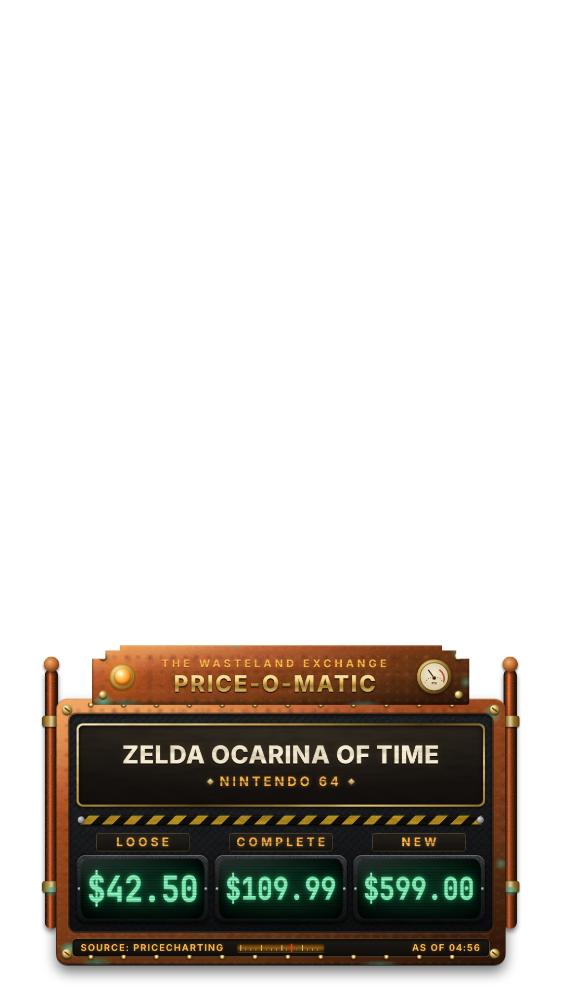
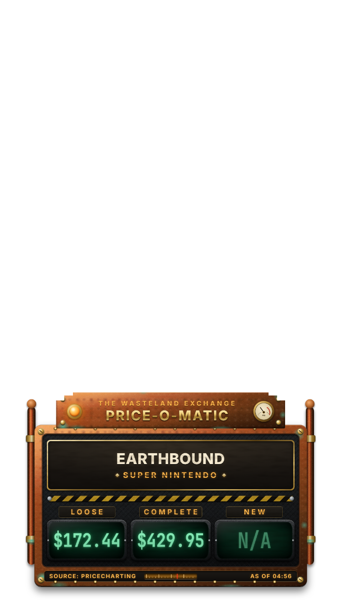
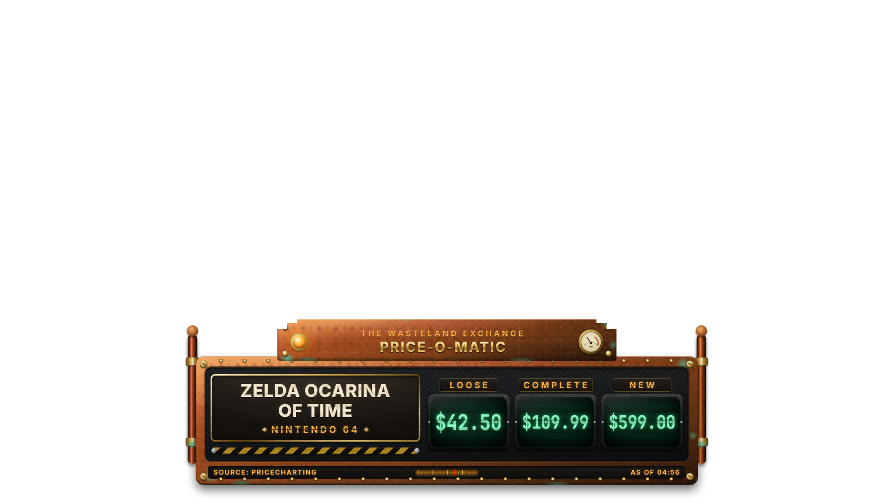

# Whatnot AI Game Overlay — *The Wasteland Exchange · Price-O-Matic*

Hold a retro video game up to your Sony ZV-1 during a Whatnot auction. The app identifies the
game and its console with Claude Vision, validates the match against the PriceCharting catalog,
fetches the current **Loose / Complete / New** market values from the official PriceCharting API,
and shows them on your stream in an animated OBS overlay — automatically, game after game.



| Long title | Six-figure prices | Missing value (`N/A`) | 16:9 layout |
|---|---|---|---|
|  |  |  |  |

*(Screenshots are rendered by the automated browser tests with mock PriceCharting data; the
background is transparent in OBS. Fonts on Windows use Bahnschrift, so text looks slightly
different from these Linux renders.)*

> **Status:** fully implemented and tested with mocks, fakes and a real browser. It has **not yet
> been run against your live OBS, Sony ZV-1, Anthropic account or PriceCharting account** — those
> need your credentials and hardware. See [docs/PRODUCTION_READINESS.md](docs/PRODUCTION_READINESS.md)
> for exactly what was and was not verified, and the first-live-session checklist.

---

## Quick start (Windows)

1. **Install** — double-click **`Install.cmd`** (needs Python 3.12+; the script tells you how to get
   it if missing). It creates a private virtual environment, installs pinned dependencies,
   initializes the database and creates desktop shortcuts.
2. **Try the demo** — double-click **`Start-Demo.cmd`**. A dashboard opens with a simulated
   camera, simulated recognition and mock PriceCharting data, all clearly watermarked
   **DEMO DATA**. No API costs. (Demo runs on port 8766, so it can never appear on your
   live OBS source at port 8765.)
3. **Go live** — double-click **`Start.cmd`**. The dashboard opens and the **setup wizard** walks
   you through:
   - Anthropic API key, PriceCharting API token, OBS WebSocket password
     (stored in Windows Credential Manager — never in files or browser code),
   - connecting to OBS and choosing the Sony ZV-1 source,
   - drawing the presentation area (crop) and capturing an empty-background reference,
   - overlay size/position, and adding the overlay to OBS.
4. **Add the overlay to OBS** — Browser Source, URL **`http://127.0.0.1:8765/overlay`**, width ×
   height = your canvas (1080 × 1920 vertical). Full steps: [docs/OBS_SETUP.md](docs/OBS_SETUP.md).

Then hold a game steady inside the presentation area. Normal flow: ~2–5 s from a steady,
readable game to prices on screen (depends on Claude latency; not yet measured live).

---

## What viewers see

**THE WASTELAND EXCHANGE — PRICE-O-MATIC**: an original scavenged appraisal console — hammered
copper frame with verdigris patina, brass rivets and screws, copper pipes, a stamped-steel inset,
a breathing amber signal lamp and pressure gauge, an industrial hazard stripe, amber stencil
labels and three mint-green CRT readouts.

- Only the machine is opaque; everything else is transparent.
- Game title (wraps to two lines, shrinks gracefully for very long titles) and the exact console.
- **Exactly three prices: LOOSE, COMPLETE, NEW** — 100% of the PriceCharting values, never
  adjusted. Missing values show **N/A**, never `$0.00`. Each readout auto-fits so six-figure
  prices stay inside the glass while normal prices stay huge.
- Footer: `SOURCE: PRICECHARTING` (editable for your commercial-agreement wording) and
  `AS OF HH:MM` (the PriceCharting retrieval time). Stale data allowed by policy is labeled
  `CACHED · AS OF …`.
- Game changes animate as one complete ~300 ms mechanical panel swap; the title and all prices
  change in the same frame. `prefers-reduced-motion` (or the *Reduce motion* setting) disables
  animation.
- Presets: **compact / balanced / large** × **bottom-left / bottom-center / bottom-right**
  (default *balanced bottom-center*), plus top and side positions, opacity, font scale and edge
  offset. Portrait and landscape layouts are chosen automatically from the canvas shape.
- All decoration is CSS/inline SVG — no external images, fonts or CDNs.

## How recognition stays accurate

```
OBS GetSourceScreenshot (camera input only — never program output, so the overlay is never re-read)
  → local motion/stability detection (no API cost)  → still the same game?  → do nothing
  → high-quality burst + blur/brightness check       → reuse earlier identification if visually identical
  → Claude Vision (schema-validated JSON: title, console, region, edition, evidence, confidence)
  → PriceCharting /api/products candidates → strict validation:
        console family AND region must match (Genesis ≠ SNES, NTSC ≠ PAL)
        title similarity ≥ threshold, clear lead over runner-up, sequels/numbers significant
        editions (Player's Choice, Greatest Hits, …) only when printed on the item
  → /api/product prices (cache ≤ 1 h, refresh otherwise) → ONE atomic record → overlay
```

- AI confidence is never treated as proof; anything ambiguous goes to the dashboard as
  **Needs confirmation** with one-click suggestions (keys **1–9**) — no guessed prices.
- A newer presentation cancels older lookups; late/out-of-order responses are discarded.
- Replacing a high-confidence game requires corroboration from a second frame.
- If a different item can't be identified, the old prices disappear after a grace period.
- Operator corrections are remembered: the same recognition maps to your chosen product next time.

## Pricing rules (enforced in code and tests)

| Overlay | PriceCharting field |
|---|---|
| LOOSE | `loose-price` |
| COMPLETE | `cib-price` |
| NEW | `new-price` |

- Integer pennies converted exactly: `4295 → $42.95`. Retail buy/sell, graded and
  box/manual-only prices are never substituted.
- Every PriceCharting request goes through one serialized queue: **never more than one request
  per second** (default spacing 1.2 s; cannot be set below 1.0 s), with backoff on 429/5xx.
- Prices, matches and searches are cached separately (SQLite). Cached prices older than the
  refresh interval (default 1 h) are refreshed before display; if the refresh fails they are
  **hidden** (default) or shown labeled `CACHED` (optional, bounded by a maximum age).
- The product ID is kept with every result and linked in the dashboard
  (`https://www.pricecharting.com/game/<id>`).

## Operator dashboard (private)

Opened automatically by `Start.cmd` (one-click sign-in link; also printed in the console and
available via `.venv\Scripts\python -m gameoverlay login-url`).

- Live status: OBS, camera source, Claude, PriceCharting, detection, overlay (and how many OBS
  browser sources are connected), estimated Claude spend vs. your session limit.
- Current item: captured still, recognition details and evidence, matched product, prices with
  FRESH / CACHED / STALE badge, suggestions.
- Controls: pause/resume **P**, scan now **S**, hold **H**, clear **C**, refresh prices **R**,
  search **/**, UPC **U**, pick suggestion **1–9**. USB barcode scanners work anywhere on the page.
- On-air preview (exactly what OBS shows) and watermarked design samples (long title, six-figure,
  low values, N/A).
- History with instant **Recall**, settings for every threshold, crop editor, setup wizard.

## Security

- Binds to `127.0.0.1` only (refuses other addresses unless you explicitly override).
- Overlay endpoints are public **read-only**; everything else needs the local admin session
  (HttpOnly SameSite=Strict cookie, CSRF token, Host/Origin checks against DNS rebinding).
- API keys/passwords live in Windows Credential Manager (or env vars) and are never sent to any
  browser, logged, or stored in the project folder. Logs scrub tokens automatically.
- The OBS client can only send read-only requests (it cannot start/stop streams or change scenes).

## Development

```powershell
Install.cmd -WithTests          # adds pytest + Playwright Chromium
Run-Tests.cmd                   # Python + browser + JS tests (Node.js optional)
Run-Tests.cmd -Live             # also live tests (needs real credentials; costs a few cents)
.\scripts\start.ps1 -Dev        # debug logging + auto-reload
.venv\Scripts\python -m gameoverlay check --live   # connectivity self-check
```

Modes: `production` (default), `development` (debug + reload), `test` (isolated DB), plus `--demo`.
Configuration: [.env.example](.env.example). Data lives in `%LOCALAPPDATA%\WhatnotGameOverlay`
(database, logs, dashboard token) — outside the project folder and never committed.

Linux/macOS (development only): `python3 -m venv .venv && .venv/bin/pip install -r requirements-dev.txt && .venv/bin/python -m gameoverlay serve --demo`.

## Documentation

- [docs/OBS_SETUP.md](docs/OBS_SETUP.md) — exact OBS + Sony ZV-1 setup
- [docs/TROUBLESHOOTING.md](docs/TROUBLESHOOTING.md)
- [docs/ARCHITECTURE.md](docs/ARCHITECTURE.md) — components, state machine, safety invariants
- [docs/PRODUCTION_READINESS.md](docs/PRODUCTION_READINESS.md) — audit: implemented, tested, verified, remaining

## Design source note

The brief referenced a visual prototype file `wasteland_price_overlay.html` and a preview PNG.
Those files were **not included** with the request (only the written design brief was), so the
overlay was built directly from that brief. If you send the prototype, the CSS in
`gameoverlay/web/overlay/overlay.css` can be aligned to it closely; the data contract
(`window.setGameOverlayData(record)`) is already compatible.
